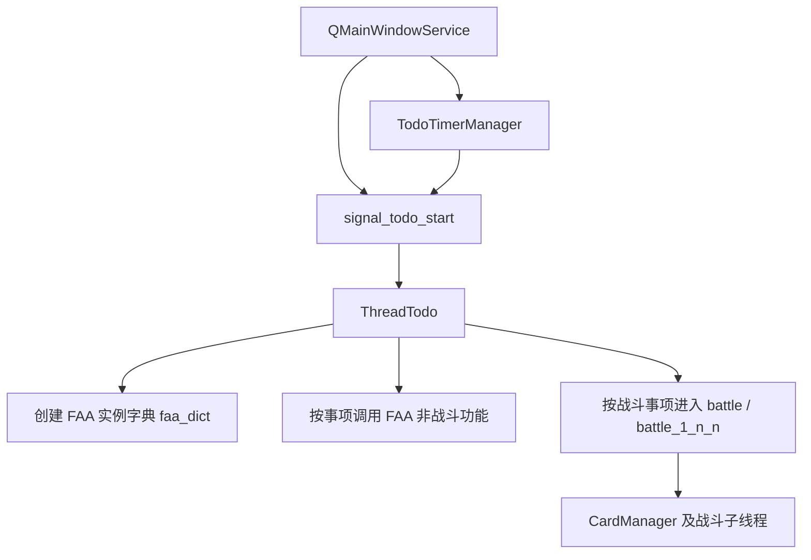

# 运行时编排与 FAA 核心

## 模块职责

这一层解决“用户点了开始之后到底谁去干活”的问题。它主要分为两部分：

- `QMainWindowService`
  负责接收 UI 指令、创建线程、控制定时器和附属能力。
- `ThreadTodo` + `FAA`
  负责把配置转换成具体的游戏操作、战斗任务和事项流水线。

## 关键文件/类

- `function/core/qmw_3_service.py`
  `QMainWindowService` 与 `faa_start_main()`
- `function/core/todo.py`
  `ThreadTodo`
- `function/scattered/todo_timer_manager.py`
  定时执行管理
- `function/core/faa/faa_mix.py`
  `FAA` 聚合入口
- `function/core/faa/faa_core.py`
  FAA 主体能力；背包消耗品通过 `use_bag_consumables()` 转发到独立背包模块。
- `function/scattered/bag_operations.py`
  背包操作集合，包含装备整理、真实空尾识别、普通批量消耗及白名单限次使用。
  使用数量写在物品字典中，例如 `use_bag_consumables(items={"A.png": 3, "B.png": 6})`。
  仅扫描使用同一种字典形式：`items={"A.png": 0, "B.png": 0}, scan_only=True`。
  数量999表示最多确认消耗999个，不表示无限；普通使用返回确认消耗量字典，扫描返回实际库存字典。
  使用最多三轮，每轮依次整理、完整扫描占用前缀、使用本轮快照中的物品；额度和连续失败计数在三轮间共享。
  新开出的消耗品即使填入前方已清空的格子，也由下一轮重新扫描发现；无可用物品或额度用尽时提前结束。仅扫描执行一轮。
  扫描按九列49px网格构建带绝对行号的内存视图，核准重合页，遇整理后的真实空尾截止；未知图标仍占格。
  相同图标在所有格子都参与识别，所有堆叠累计数量，不能因已找到一个而跳过其余格子。
  常规匹配裁剪为与模板同样大小；小尺寸特征首次仅在单格内定位，缓存其格内偏移后复用。
  每次使用核对真实数量，连续三次未减少，通过现有 `SIGNAL.DIALOG` 提示道具栏可能已满，放弃整次调用的剩余物品。
  成功扣减清零该物品的连续失败计数；数字读不清时单独停止，不能当作0或未减少。每种物品最多尝试需求量的三倍。
  普通物品提交后每40ms等待奖励窗或数量变化，最多3秒；没有变化仍交给数量复核处理，不按固定500ms判完成。
  单件与多件奖励统一在两个小范围内识别普通/悬停红叉，点击识别到的中心，不使用固定点快捷关闭。
  单件范围为[432,178,466,208]，多件范围为[680,188,714,218]，均为34×30像素；包含实测状态及关闭动画的必要位移余量。
  关闭检查复用同一张截图，每40ms一次、最多3秒；每种奖励窗只点击一次，确认奖励及使用菜单退出后等待20ms继续。
  整理前复用同一关闭流程，卡包扫描不附带固定点关闭点击。
  普通消耗品每次提交前后复用数量截图核对原图标。最后一件用完后，同格连续两帧变成其他图标时结束旧堆；
  新物品只由下一轮重新扫描及白名单处理，不能把新物品的数量当成原物品未减少而重试。
  定向调用可复用库存扫描和同堆位置记忆，返回批末实测库存、提交数及确认数；模块不依赖独立强卡工程。
  未知图标不当空格，未开放尾格不当使用耗尽证据。
  双暴卡任务仅保留北京时间周六、周日跳过的业务判断，工作日委托该模块使用双暴卡模板。
- `function/core/faa/faa_action_interface_jump.py`
  地图/界面跳转
- `function/core/faa/faa_action_receive_quest_rewards.py`
  奖励领取相关动作
- `function/core/faa/faa_battle_preparation.py`
  战前准备和战后收尾
- `function/core/faa/faa_battle.py`
  战斗过程动作

## 线程与执行关系

## `QMainWindowService`

### 主要职责

- 保有主线程状态：
  - `thread_todo_1`
  - `thread_todo_2`
  - `todo_timer_manager`
- 管理主按钮：
  - 一键启动
  - 定时启动
  - 保存配置
  - 窗口隐藏/缩放
- 管理附属窗口：
  - 战斗方案编辑器
  - 关卡方案编辑器
  - 配置迁移器
  - 实用工具
  - 多个说明弹窗
- 管理杂项功能：
  - 自启动
  - 米苏物流链接测试与线上关卡信息同步
  - 公会管理器数据刷新
  - QQ空间与 4399 密码登录信息保存

### 启停逻辑

- `todo_start()`
  - 根据当前配置创建 `FAA` 实例
  - 创建并启动 `ThreadTodo`
  - 记录线程状态，锁定相关按钮
- `todo_end()`
  - 从外到内中断线程
  - 清理 `ThreadTodo` 和内部线程
  - 恢复 UI 可操作状态

## `ThreadTodo`

### 主要职责

`ThreadTodo` 是真正的编排器。它把 `settings.json`、任务序列、关卡方案和战斗方案组合起来，执行一整趟事项。

### 任务族

按代码职责可以把 `todo.py` 的方法分成几组：

- 账号与环境维护
  - 启动/关闭 360
  - 刷新游戏
  - 返回登录界面
- 日常事项
  - 签到
  - 浇水/施肥/摘果
  - 删除物品
  - 使用消耗品
  - 暗晶兑换
  - 温馨礼包
- 奖励与任务
  - 领取任务奖励
  - 扫描公会/情侣/悬赏/大赛任务
  - 查漏补缺
- 战斗事项
  - 单关多次
  - 多关多次
  - 工会任务/情侣任务/悬赏/世界 Boss/魔塔/萌宠神殿
  - 全自动大赛
- 自定义事项
  - 任务序列
  - 扩展脚本
  - 天知强卡器联动

### 运行模式

删除背包道具时，`FAABase.delete_items()` 每轮点击下滑 2 次，共扫描 11 次（首屏 + 10 轮下滑），
累计下滑 20 次仍覆盖底部。相邻扫描保留更多重叠，避免 75 格满背包时道具一直处于不完整显示状态。

- 常规模式：`thread_todo_1` 负责完整任务序列与大多数事项编排。
- 组队战斗：主线程内部可以驱动 1P/2P 协作完成组队事项。
- 双线程单人作战：`thread_todo_2` 只在特定战斗场景下被主线程信号拉起，负责 2P 的 `battle_1_n_n()` 支线执行。

`battle_1_1_n()` 在绑定 FAA 对象前统一确定参与账号和房主。单人魔塔、魔塔密室、世界 Boss
收到组队参数时转为 1P 单人；其他自动建房的组队任务中，跨服固定由 1P 当房主，常规关卡固定由 2P 当房主。
常规邀请直接选择好友列表首项，因此要求 2P 仅添加 1P 为好友。自建房保留传入的房主顺序，
原本的单人任务保留选定账号。战斗方案按 1P、2P 各自的账号编号绑定，退出策略中的 a/b 分别对应房主、队友。
运行时调整玩家顺序不会改写任务配置中的原始列表。

代码里的副线程不是“任意双号全并行编排器”，而是为若干多线程单人战斗场景准备的辅助线程。

`FAABase.sign_top_up_money()` 的五处充值致命失败分支会在函数内部调用当前玩家的 `reload_game()`，
返回日氪结果说明与恢复登录的错误原因。恢复过程不重试本次充值，避免已经扣款但复核或退出失败时重复充值。
`ThreadTodo.batch_top_up_money()` 在恢复登录失败后返回原因，不继续下一玩家或签到操作。

`FAABase.reload_game()` 成功返回 `(True, "")`。连续十次刷新失败时，若开启自动启动游戏大厅，
则仅关闭当前账号的游戏窗口，按配置的小号编号重新启动，再尝试十次；每次调用最多重开一次。
未开启自动启动，或重开后的十次刷新仍失败时，返回 `(False, 原因)`。
区服、登录凭据等确定无效的配置直接返回失败；自动启动的小号编号或大厅路径未配置时，
十次刷新失败后保留现有窗口并返回配置错误。
登录核心和批量刷新不弹出错误框；`ThreadTodo.batch_reload_game()` 将目标玩家的失败原因汇总为字符串，
成功返回 `None`。业务动作遇到该原因立即向调用方返回，正常完成或跳过返回 `None`。
`task_sequence()` 返回“是否运行常规任务、是否运行自建房、失败原因”三个值，失败后不继续后续事项。
主、副任务入口将失败原因交给主窗口；主窗口停止本轮全部任务并只提示一次，失败时不执行任务完成后的操作。
意外程序异常继续使用通用线程异常处理，保留调用栈。

`ThreadWithException` 通过 `return_value` 原样传递业务返回值；目标函数抛出异常或被中断时，结果保留为 `None`。
批量刷新、日氪和浇水施肥遇到线程无结果时返回中断原因，阻止后续事项。浇水施肥的调度入口将正常完成的
`None` 转为空字符串，以区别正常完成和线程未返回结果；预期业务失败仍返回原原因。

## `FAA` 核心对象

### 对象结构

`FAA` 在 `faa_mix.py` 中通过多继承组合多个能力块：

- `FAABase`
  核心状态、关卡配置、方案解析、日常功能主体。
- `FAAActionInterfaceJump`
  地图与界面跳转。
- `FAAActionReceiveQuestRewards`
  奖励领取相关动作。
- `BattlePreparation`
  选卡、换卡组、进房、结算、翻牌、掉落识别。
- `FAABattle`
  战斗中动作，如放卡、用铲、拾取、波次检测、结束检测。

当前代码中 `FAASynthesis` 仍处于注释状态，没有真正加入 `FAA` 聚合类。

### FAA 的状态边界

`FAA` 不是纯工具类，而是重状态对象。它持有：

- 渠道与玩家信息
- 句柄与窗口状态
- 当前关卡与 `stage_info`
- 当前战斗方案与解析结果
- 战斗中的动态状态，如波次、是否用钥匙、自动拾取、记录器对象

## 典型执行链

- 主窗口读取配置并创建 `FAA`
- `ThreadTodo` 判断当前事项类型
- 如果是非战斗事项，直接调用 `FAA` 的日常方法
- 如果是战斗事项：
  - 设置关卡与方案
  - 进房并换卡组
  - 启动战斗
  - 收尾并记录掉落

## 扩展点

- 新增事项类型：
  - 优先落在 `ThreadTodo`，补充任务参数解析和执行入口
- 新增窗口内按钮行为：
  - 放在 `QMainWindowService`
- 新增游戏动作：
  - 如果是导航行为，放 `faa_action_interface_jump.py`
  - 如果是战前/战后行为，放 `faa_battle_preparation.py`
  - 如果是战斗中动作，放 `faa_battle.py`

## 常见坑

- `ThreadTodo` 文件极大，但它的核心职责始终是“编排”，不要把底层窗口操作继续堆进去。
- `FAA` 是重状态对象，跨方法共享大量字段；改某个流程时要注意它会不会影响后续战斗轮次。
- 双线程模式下大量地方依赖 `EXTRA.FILE_LOCK` 和线程同步；读写方案、日志和结果文件时要格外小心。
